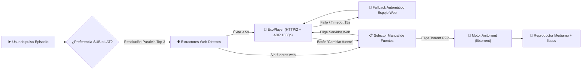
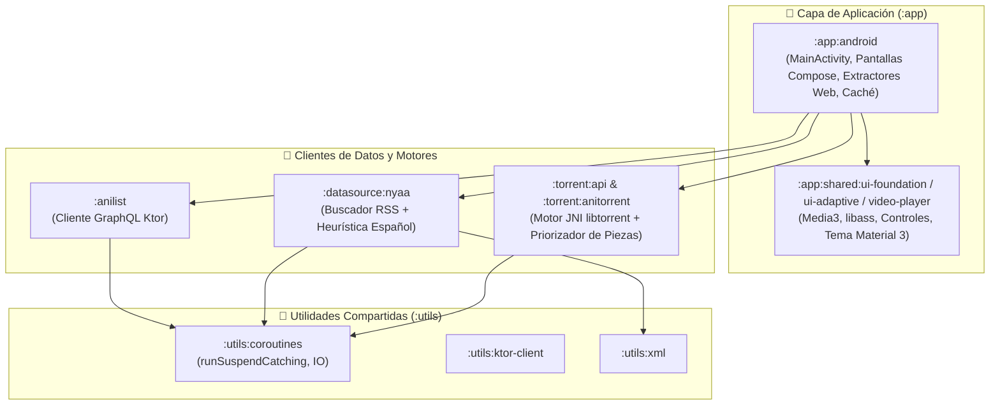

<div align="center">


# Yokan

**Reproductor y catálogo de anime para Android con streaming web directo de ultra-baja latencia, selector instantáneo `SUB ⇄ LAT` y motor BitTorrent P2P.**

[](https://github.com/prabarxx/Yokan/actions/workflows/android-release.yml)
[](https://github.com/prabarxx/Yokan/releases/latest)
[-3DDC84?style=for-the-badge&logo=android&logoColor=white)](https://developer.android.com)
[](https://kotlinlang.org)
[](https://developer.android.com/jetpack/compose)
[](LICENSE)

[**📲 Descargar última versión**](https://github.com/prabarxx/Yokan/releases/latest) · [**⚙️ GitHub Actions**](https://github.com/prabarxx/Yokan/actions) · [**🐛 Reportar un problema**](https://github.com/prabarxx/Yokan/issues)

</div>

---

## 🌟 Descripción General

**Yokan** es una aplicación nativa de anime para Android diseñada para ofrecer **reproducción instantánea sin anuncios ni WebViews intermedios**. Combina el catálogo global de **AniList GraphQL** con un motor híbrido que prioriza la extracción directa de streams web (`HLS` / `MP4` 1080p) y ofrece soporte bajo demanda para streaming P2P mediante **BitTorrent (`Anitorrent` / `libtorrent`)**.

> [!TIP]
> **Cambio de idioma en un toque (`SUB ⇄ LAT`):** Elige entre **Subtitulado (`SUB`)** y **Español Latino (`LAT`)** directamente desde la ficha del anime o cámbialo en vivo desde la barra superior del reproductor sin perder el segundo exacto de reproducción.

---

## ✨ Características Principales

| Categoría | Funcionalidad | Detalles Técnicos |
| :--- | :--- | :--- |
| 🚀 **Streaming Web Prioritario** | Arranque inmediato sin anuncios | Resolución paralela con caché TTL en RAM, arranque rápido en 720p y escalado adaptativo automático a **1080p (`STATE_READY`)** sobre HTTP/2 (`OkHttp`). |
| 🎙️ **Dual Audio (`SUB ⇄ LAT`)** | Subtitulado y Español Latino | Detección automática de disponibilidad de doblaje latino por serie y conmutación en caliente dentro del reproductor conservando el progreso. |
| 🧲 **Motor P2P Bajo Demanda** | Torrents Nyaa.si + `Anitorrent` | Búsqueda concurrente controlada (`Semaphore`), heurística de semillas/español (`SubsPlease`, `Erai-raws`) y ventana deslizante de piezas con prioridad `deadline = 0`. |
| 🎬 **Reproductor Nativo** | Media3 (ExoPlayer) + `libass` | Renderizado nativo de subtítulos estilizados **ASS/SSA**, gestos táctiles de brillo/volumen, *swipe-to-seek* con previsualización, salto `+85s`/`+90s` (OP/ED) y auto-siguiente episodio. |
| 🧠 **Catálogo Inteligente** | AniList GraphQL + Ediciones Especiales | Tendencias, populares, búsqueda instantánea, árbol cronológico de franquicias (precuelas/secuelas) e integración transparente de versiones **Director's Cut / Sin Censura**. |
| 💾 **Continuar Viendo y Caché** | Persistencia asíncrona segura | Historial local no bloqueante (`Dispatchers.IO` con *debounce*), avance automático al episodio `N+1` al superar el `92%` y gestor de almacenamiento por `infoHash`. |

---

## 🔄 Flujo de Resolución y Reproducción

El siguiente diagrama ilustra cómo **Yokan** resuelve un episodio desde que el usuario pulsa **Reproducir**:



---

## 🌐 Fuentes y Extractores Soportados

**Yokan** extrae los flujos de video crudos (`.m3u8` / `.mp4`) directamente en segundo plano, descartando servidores que obligan a usar navegador o inicio de sesión:

| Prioridad | Servidor / Fuente | Tipo de Flujo | Resolución | Características del Extractor |
| :---: | :--- | :---: | :---: | :--- |
| **1** | **MP4Upload** | `MP4 Progresivo` | `1080p` | Extracción directa + desempacador JS (`Dean Edwards Packer`) y cabeceras dedicadas. |
| **2** | **UPNShare (`uns.bio`)** | `HLS (.m3u8)` | `1080p` | Descifrado nativo **`AES-128-CBC`** del payload hexadecimal y CDN Cloudflare (`cfNative`). |
| **3** | **YourUpload** | `MP4 Progresivo` | `1080p` | Resolución directa de enlace multimedia con inyección de `Referer` dinámico. |
| **4** | **Voe** | `HLS (.m3u8)` | `720p / 1080p` | Seguimiento automático de redirecciones JS y decodificación de manifiestos en `Base64`. |
| **5** | **VidHide / Filemoon** | `HLS (.m3u8)` | `1080p` | Desofuscación de bloques `eval(function(p,a,c,k,e,d)...)` y extracción de master playlist. |
| **6** | **StreamTape** | `MP4 Progresivo` | `720p` | Reconstrucción de tokens dinámicos `get_video` sin ejecución de WebView. |
| **Manual** | **Nyaa.si (BitTorrent)** | `P2P (MKV / MP4)` | `1080p / 720p` | Selección manual por el usuario; prioriza `Multi-Subs` / `SPA` y lotes (*batches*) completos. |

---

## 🏗️ Arquitectura Modular

El proyecto está estructurado siguiendo principios de **Kotlin Multiplatform (KMP)** y separación estricta de responsabilidades:



<details>
<summary><b>📂 Ver estructura detallada de directorios</b></summary>

```text
Yokan/
├── app/
│   ├── android/                        # Aplicación Android principal
│   │   └── src/main/kotlin/app/yokan/
│   │       ├── datasource/animeav1/    # Extractores directos, cifrado AES-128 y TtlCache
│   │       ├── media/                  # WatchHistoryManager, CacheStorageManager, TorrentManager
│   │       └── ui/                     # MainActivity, HomeScreen, AnimeDetailsScreen, VideoPlayerScreen
│   └── shared/
│       ├── app-platform/               # Abstracciones de plataforma e inyección de componentes
│       ├── ui-foundation/              # Sistema de diseño Material 3, iconos e imágenes asíncronas
│       └── video-player/               # Integración ExoPlayer + decodificador nativo libass
├── anilist/                            # Cliente GraphQL sin estado para AniList
├── datasource/
│   ├── api/                            # Contratos base de fuentes multimedia
│   └── nyaa/                           # Motor de búsqueda Nyaa.si con puntuación heurística y Semaphore
├── torrent/
│   ├── api/                            # Interfaces de sesiones, handles y piezas BitTorrent
│   └── anitorrent/                     # Implementación nativa sobre libtorrent
└── utils/
    ├── coroutines/                     # Extensiones de concurrencia estructurada (runSuspendCatching)
    ├── io/                             # Abstracción multiplataforma de sistema de archivos
    └── xml/                            # Parser XML ligero para feeds RSS
```

</details>

---

## 📲 Instalación y Descarga

No necesitas compilar el proyecto manualmente. Cada versión etiquetada genera y publica los APKs optimizados en la sección de [**Releases**](https://github.com/prabarxx/Yokan/releases/latest):

| Archivo APK | Arquitectura | ¿Cuál debo descargar? |
| :--- | :---: | :--- |
| 📦 **`yokan-arm64-v8a.apk`** | `ARM64 (64-bit)` | **Recomendado** para el 99% de teléfonos y tablets Android modernos. Más ligero y rápido. |
| 📦 **`yokan-universal.apk`** | `arm64-v8a`, `armeabi-v7a`, `x86_64` | Para dispositivos antiguos de 32 bits, Android TV Boxes o emuladores en PC. |

> [!NOTE]
> Al instalar el APK por primera vez, Android solicitará permiso para instalar aplicaciones de orígenes desconocidos en tu navegador o gestor de archivos.

---

## ⚙️ Compilación en CI/CD (GitHub Actions)

> [!IMPORTANT]
> La compilación de producción (incluyendo las bibliotecas nativas JNI y la optimización R8/ProGuard) está automatizada íntegramente mediante **GitHub Actions** en el flujo [`.github/workflows/android-release.yml`](.github/workflows/android-release.yml).

<details>
<summary><b>🔧 Cómo disparar un nuevo build o release en GitHub Actions</b></summary>

1. **Compilación automática de prueba (Artefactos):**
   Cualquier `git push origin main` dispara el flujo **Build Yokan Android APK**, generando `yokan-arm64-v8a.apk` y `yokan-universal.apk` como artefactos descargables desde la pestaña **Actions**.
2. **Publicación automática de Release:**
   Al crear y subir un tag con prefijo `v*`, el workflow compila los APKs firmados y crea automáticamente la publicación en **GitHub Releases**:
   ```bash
   git tag v2.4.6
   git push origin main --tags
   ```
3. **Ejecución manual (`workflow_dispatch`):**
   También puedes lanzar la compilación en cualquier momento desde la pestaña **Actions → Build Yokan Android APK → Run workflow**.

</details>

---

## 📜 Licencia

Este proyecto se distribuye bajo los términos de la licencia **GNU Affero General Public License v3.0 (AGPL-3.0)**. Consulta el archivo [LICENSE](LICENSE) para más información.
