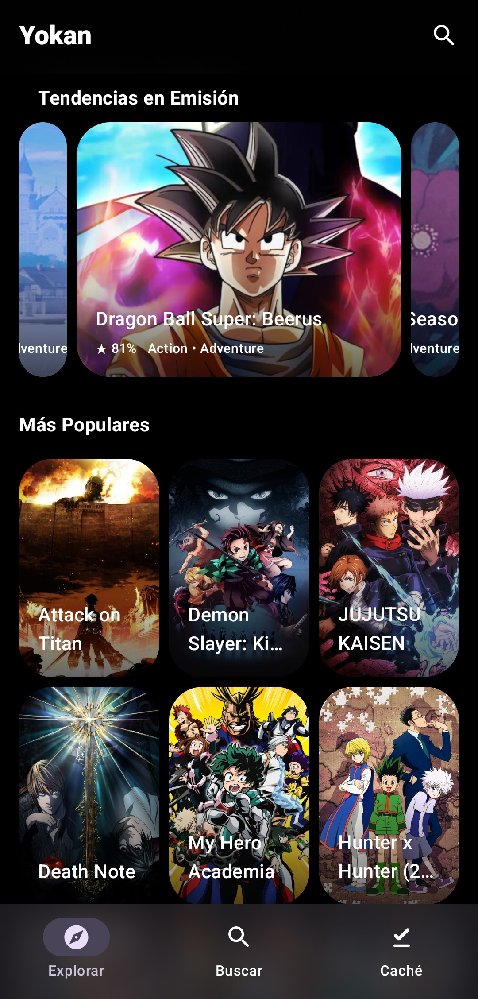
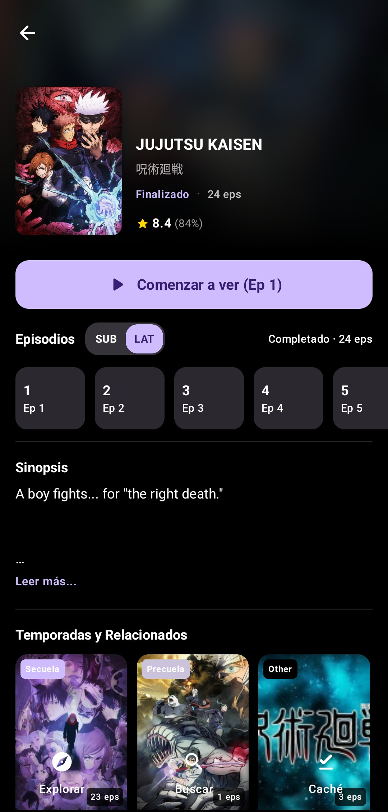
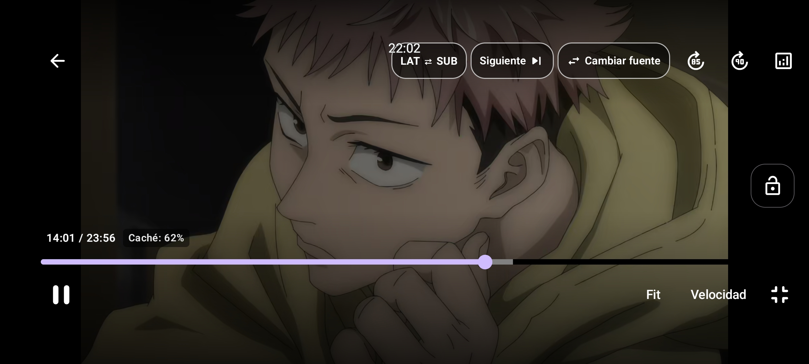

<div align="center">


# Yokan

**Cliente y reproductor nativo de anime para Android con streaming web directo de baja latencia, selector de idioma en vivo (`SUB / LAT`) y soporte BitTorrent P2P.**

[](https://github.com/prabarxx/Yokan/actions/workflows/android-release.yml)
[](https://github.com/prabarxx/Yokan/releases/latest)
[-3DDC84?style=for-the-badge&logo=android&logoColor=white)](https://developer.android.com)
[](https://kotlinlang.org)
[](https://developer.android.com/jetpack/compose)
[](LICENSE)

[**Descargar última versión**](https://github.com/prabarxx/Yokan/releases/latest) · [**GitHub Actions**](https://github.com/prabarxx/Yokan/actions) · [**Reportar un problema**](https://github.com/prabarxx/Yokan/issues)

</div>

---

## Descripción General

**Yokan** es una aplicación nativa de anime para Android diseñada para ofrecer reproducción inmediata sin anuncios ni navegadores intermedios. Integra el catálogo de **AniList GraphQL** con un motor de reproducción híbrido que prioriza la extracción directa de flujos web (`HLS` / `MP4` 1080p) y habilita bajo demanda el streaming P2P mediante **BitTorrent (`Anitorrent` / `libtorrent`)**.

> [!TIP]
> **Selector de idioma instantáneo (`SUB / LAT`):** Permite alternar entre **Subtitulado (`SUB`)** y **Español Latino (`LAT`)** desde la ficha del anime o directamente en la barra superior del reproductor conservando la posición exacta de reproducción.

---

## Vista Previa de la Interfaz

<div align="center">
<table>
  <tr>
    <td align="center" width="50%">
      
      <br />
      <sub><b>Catálogo Principal y Tendencias en Emisión</b></sub>
    </td>
    <td align="center" width="50%">
      
      <br />
      <sub><b>Ficha Técnica, Franquicias y Selector <code>SUB | LAT</code></b></sub>
    </td>
  </tr>
  <tr>
    <td colspan="2" align="center">
      
      <br />
      <sub><b>Reproductor Nativo 1080p con Conmutación <code>LAT / SUB</code> en Vivo, Salto de Opening y Selector de Fuentes</b></sub>
    </td>
  </tr>
</table>
</div>

---

## Características Principales

| Categoría | Funcionalidad | Implementación Técnica |
| :--- | :--- | :--- |
| **Streaming Web Prioritario** | Reproducción directa sin anuncios | Resolución paralela con caché `TTL` acotada en memoria, inicio rápido en 720p y escalado adaptativo automático a **1080p (`STATE_READY`)** sobre HTTP/2 (`OkHttp`). |
| **Audio Dual (`SUB / LAT`)** | Subtitulado y Español Latino | Detección automática de disponibilidad de doblaje latino por serie y conmutación en caliente dentro del reproductor sin reiniciar el progreso del episodio. |
| **Motor P2P Bajo Demanda** | Torrents Nyaa.si + `Anitorrent` | Búsqueda concurrente controlada (`Semaphore`), heurística de semillas e idioma (`SubsPlease`, `Erai-raws`) y priorización secuencial de piezas (`deadline = 0`). |
| **Reproductor Nativo** | Media3 (ExoPlayer) + `libass` | Renderizado nativo de subtítulos estilizados **ASS/SSA**, gestos táctiles de brillo y volumen, búsqueda deslizando con vista previa, salto `+85s`/`+90s` y avance automático de episodio. |
| **Catálogo y Franquicias** | AniList GraphQL + Ediciones Especiales | Tendencias, populares, búsqueda en tiempo real, orden cronológico de franquicias (precuelas/secuelas) y soporte integrado para versiones **Director's Cut / Sin Censura**. |
| **Persistencia y Caché** | Historial y almacenamiento seguro | Escritura asíncrona no bloqueante (`Dispatchers.IO` con *debounce*), avance automático al episodio `N+1` al superar el `92%` y gestión de caché indexada por `infoHash`. |

---

## Flujo de Resolución y Reproducción

Cuando el usuario selecciona un episodio, **Yokan** ejecuta el siguiente pipeline de resolución:

1. **Selección de Idioma (`SUB` o `LAT`):** Filtra y ordena los servidores compatibles según la preferencia activa del usuario.
2. **Extracción Directa Paralela:** Consulta en paralelo los 3 servidores prioritarios con un límite de respuesta de 5 segundos y valida la caché `TTL` en memoria.
3. **Reproducción Adaptativa (`ExoPlayer`):** Inicia la reproducción sobre `OkHttp` con soporte `HTTP/2`, desbloqueando automáticamente los perfiles `1080p` tras alcanzar `STATE_READY`.
4. **Conmutación por Error (Failover Automático):** Si un flujo web presenta un error HTTP o supera los 15 segundos de carga inicial, el reproductor descarta el enlace en caché y conmuta automáticamente al siguiente espejo disponible.
5. **Selección Manual y P2P (BitTorrent):** Desde el selector de fuentes, el usuario puede cambiar manualmente de servidor web o activar un torrent P2P de **Nyaa.si**, gestionado por el motor nativo `Anitorrent` (`libtorrent` + `libass`).

---

## Fuentes y Extractores Soportados

**Yokan** extrae los flujos de video crudos (`.m3u8` / `.mp4`) directamente en segundo plano, descartando contenedores web con publicidad o requisitos de inicio de sesión:

| Prioridad | Servidor / Fuente | Protocolo | Resolución | Detalles del Extractor |
| :---: | :--- | :---: | :---: | :--- |
| **1** | **MP4Upload** | `MP4 Progresivo` | `1080p` | Extracción directa, desempacador JS (`Dean Edwards Packer`) y cabeceras HTTP dedicadas. |
| **2** | **UPNShare (`uns.bio`)** | `HLS (.m3u8)` | `1080p` | Descifrado nativo **`AES-128-CBC`** del payload hexadecimal y distribución por Cloudflare CDN. |
| **3** | **YourUpload** | `MP4 Progresivo` | `1080p` | Resolución directa de flujo multimedia con inyección dinámica de `Referer`. |
| **4** | **Voe** | `HLS (.m3u8)` | `720p / 1080p` | Seguimiento de redirecciones JS y decodificación de manifiestos en `Base64`. |
| **5** | **VidHide / Filemoon** | `HLS (.m3u8)` | `1080p` | Desofuscación de bloques `eval(function(p,a,c,k,e,d)...)` y extracción de *master playlist*. |
| **6** | **StreamTape** | `MP4 Progresivo` | `720p` | Reconstrucción de tokens dinámicos `get_video` sin necesidad de WebView. |
| **Manual** | **Nyaa.si (BitTorrent)** | `P2P (MKV / MP4)` | `1080p / 720p` | Selección manual bajo demanda; prioriza lanzamientos `Multi-Subs` / `SPA` y lotes completos. |

---

## Arquitectura del Proyecto

El código base está organizado en módulos desacoplados bajo **Kotlin Multiplatform (KMP)** y **Jetpack Compose**:

```text
Yokan/
├── app/
│   ├── android/                        # Aplicación Android principal
│   │   └── src/main/kotlin/app/yokan/
│   │       ├── datasource/animeav1/    # Extractores directos, descifrado AES-128 y TtlCache
│   │       ├── media/                  # WatchHistoryManager, CacheStorageManager, TorrentManager
│   │       └── ui/                     # MainActivity, HomeScreen, AnimeDetailsScreen, VideoPlayerScreen
│   └── shared/
│       ├── app-platform/               # Abstracciones de plataforma y contexto de aplicación
│       ├── ui-foundation/              # Sistema de diseño Material 3, tipografía e imágenes asíncronas
│       └── video-player/               # Integración ExoPlayer + decodificador nativo de subtítulos libass
├── anilist/                            # Cliente GraphQL para AniList (Ktor + Kotlinx Serialization)
├── datasource/
│   ├── api/                            # Contratos e interfaces base para proveedores de medios
│   └── nyaa/                           # Motor de búsqueda RSS Nyaa.si con heurística y control de concurrencia
├── torrent/
│   ├── api/                            # Definición de sesiones, handles y prioridades de piezas BitTorrent
│   └── anitorrent/                     # Puente nativo JNI sobre libtorrent
└── utils/
    ├── coroutines/                     # Utilidades de concurrencia estructurada (runSuspendCatching)
    ├── io/                             # Abstracción multiplataforma de sistema de archivos
    └── xml/                            # Analizador XML ligero para feeds RSS
```

| Módulo | Responsabilidad Principal |
| :--- | :--- |
| `:app:android` | Ciclo de vida Android, navegación, pantallas Compose, extractores web, historial y caché local. |
| `:app:shared:video-player` | Superficie de video unificada compatible con flujos HTTP (`Media3`) y flujos de piezas BitTorrent (`Mediamp` + `libass`). |
| `:anilist` | Consultas GraphQL paginadas para catálogo, búsqueda, detalles de obra y relaciones de franquicia. |
| `:datasource:nyaa` | Búsqueda paralela de torrents con filtrado de episodios, lotes (*batches*) y puntuación por idioma/semillas. |
| `:torrent:anitorrent` | Gestión de sesiones `libtorrent`, priorización de ventana deslizante de piezas y cierre limpio de recursos. |
| `:utils:coroutines` | Manejo seguro de cancelación estructurada en corrutinas (`runSuspendCatching`). |

---

## Instalación y Descarga

Cada versión etiquetada compila y publica automáticamente los paquetes APK firmados en la sección de [**Releases**](https://github.com/prabarxx/Yokan/releases/latest):

| Archivo APK | Arquitectura | Dispositivos Recomendados |
| :--- | :---: | :--- |
| **`yokan-arm64-v8a.apk`** | `ARM64 (64-bit)` | **Recomendado** para la mayoría de teléfonos y tablets Android actuales. Menor tamaño y mayor rendimiento. |
| **`yokan-universal.apk`** | `arm64-v8a`, `armeabi-v7a`, `x86_64` | Dispositivos antiguos de 32 bits, Android TV Boxes o emuladores sobre PC. |

> [!NOTE]
> Al instalar el paquete APK por primera vez, el sistema operativo solicitará autorización para instalar aplicaciones de orígenes desconocidos en el navegador o gestor de archivos utilizado. También puede gestionarse la actualización automática de versiones añadiendo la URL del repositorio (`https://github.com/prabarxx/Yokan`) en **Obtainium**.

---

## Compilación e Integración Continua (GitHub Actions)

> [!IMPORTANT]
> La compilación de producción (incluyendo las bibliotecas nativas JNI y la optimización R8/ProGuard) se ejecuta íntegramente en **GitHub Actions** a través del flujo [`.github/workflows/android-release.yml`](.github/workflows/android-release.yml).

<details>
<summary><b>Instrucciones para generar compilaciones y lanzamientos en GitHub Actions</b></summary>

1. **Compilación de prueba (Artefactos de Actions):**
   Cualquier `git push origin main` sin la etiqueta `[skip ci]` inicia el flujo **Build Yokan Android APK**, generando `yokan-arm64-v8a.apk` y `yokan-universal.apk` como artefactos descargables en la pestaña **Actions**.
2. **Publicación automática en GitHub Releases:**
   Al crear y enviar una etiqueta con prefijo `v*`, el flujo compila los APKs y publica automáticamente la versión en **GitHub Releases**:
   ```bash
   git tag v2.4.6
   git push origin main --tags
   ```
3. **Ejecución manual (`workflow_dispatch`):**
   Puede iniciarse una compilación manual en cualquier momento desde **Actions → Build Yokan Android APK → Run workflow**.

</details>

---

## Licencia

Este proyecto se distribuye bajo los términos de la licencia **GNU Affero General Public License v3.0 (AGPL-3.0)**. Consulte el archivo [LICENSE](LICENSE) para el texto legal completo.
